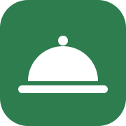
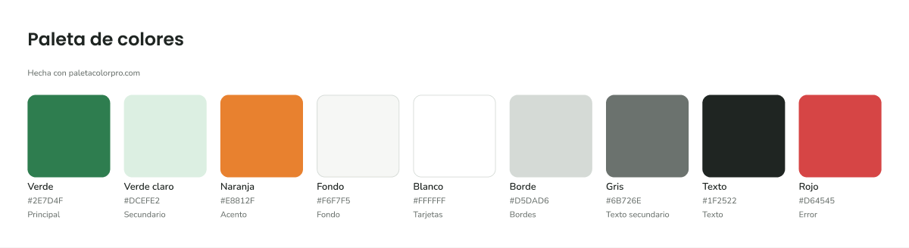
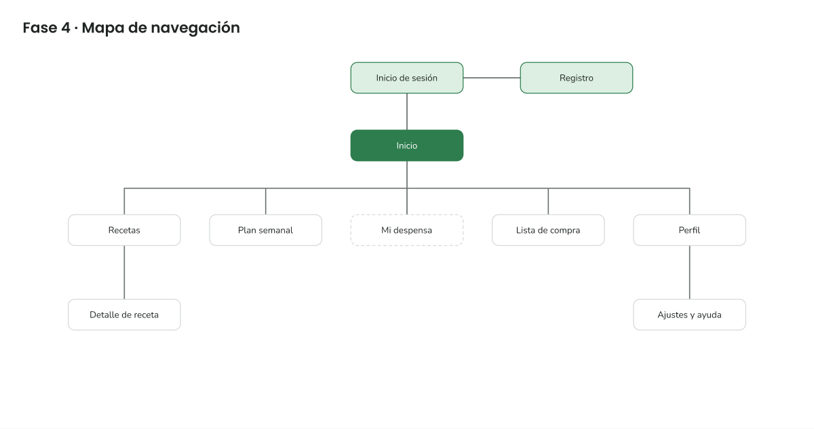
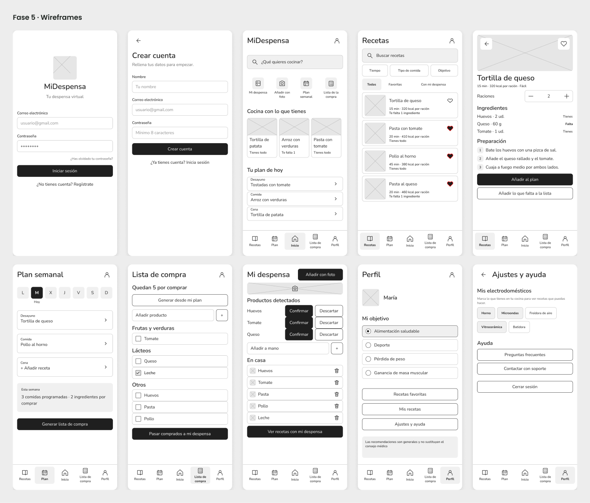
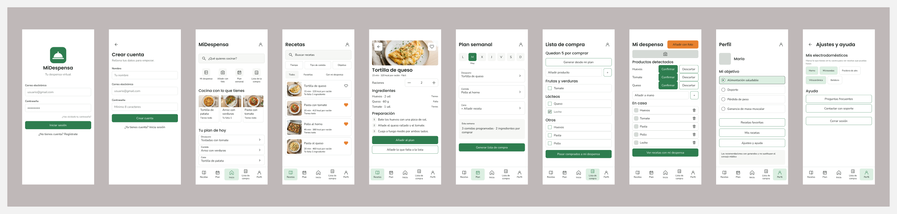

# MiDespensa

MiDespensa es una app para el móvil que te dice qué puedes cocinar con lo que ya tienes en casa. La diseñé en Figma para la asignatura de **Desarrollo de Interfaces** de 2º de DAW, desde buscar el problema hasta tener un prototipo que se puede probar.

Es solo el diseño, no hay código detrás.

- **Probar el prototipo:** [abrir en Figma](https://www.figma.com/proto/vb9seuXvZfBo7JoXm5Aj2P/MiDespensa?node-id=9-33&t=CjIrTwG453uFQZbY-1) (empieza en la pantalla de inicio de sesión)
- **Ver el archivo de Figma:** [abrir en Figma](https://www.figma.com/design/vb9seuXvZfBo7JoXm5Aj2P/MiDespensa?node-id=9-33&t=CjIrTwG453uFQZbY-1)
- **Leer la memoria completa:** [Memoria_MiDespensa_Lenin_Sailema.pdf](Memoria_MiDespensa_Lenin_Sailema.pdf)

---

## De dónde sale la idea

Me pasa muchísimo: abro la nevera, veo huevos, tomate, un poco de pasta y queso... y no se me ocurre nada. Al final acabo pidiendo comida o haciendo lo de siempre, y encima a veces se me pone mala comida porque ni me acordaba de que la tenía.

Para ver si le pasaba a más gente hice un par de entrevistas, y sí: lo que más les costaba era pensar qué hacer, les faltaba algún ingrediente justo cuando iban a cocinar y la lista de la compra se les olvidaba. Con eso hice un mapa de empatía y dejé el problema así:

> ¿Cómo podríamos ayudar a que la gente aproveche lo que tiene en casa y le cueste menos decidir qué comer?

Después hice un Crazy 8s (8 ideas en 8 minutos), puntué cada idea y me quedé con las mejores.

## Qué hace la app

- Añades lo que tienes en casa haciendo una foto al ticket o al producto, o a mano si prefieres.
- Te enseña recetas que puedes hacer con eso, con buscador y filtros.
- Te monta un plan de comidas para la semana.
- Te hace la lista de la compra con lo que te falta.
- Puedes elegir un objetivo (comer sano, deporte...) y decirle qué electrodomésticos tienes, para que te proponga cosas que de verdad puedas hacer.

Antes de empezar miré dos apps parecidas, Fitia y Supercook. Fitia está muy centrada en el fitness y en contar calorías, y en Supercook tienes que ir marcando los ingredientes uno a uno. La idea de MiDespensa es juntar lo mejor de las dos y hacerlo más fácil.

## Colores

Quería que la app se viera **saludable, sencilla y organizada**, así que elegí verde como color principal, verde claro de secundario, naranja para destacar cosas y grises para el resto. Siguiendo la regla 60-30-10: más o menos un 60% neutros, un 30% verde y un 10% naranja.

## Mapa de navegación

Así se mueve uno por la app:

## Wireframes

Las 10 pantallas en gris, para centrarme en dónde va cada cosa antes de meter colores.

## Mockups y prototipo

Las mismas 10 pantallas ya con los colores, la tipografía (Poppins para títulos y Nunito para el texto) y los componentes que hice en Figma: botones, tarjetas, filas de lista, la barra de abajo con una variante para cada pestaña...

Con estas pantallas monté el prototipo, que puedes probar [aquí](https://www.figma.com/proto/vb9seuXvZfBo7JoXm5Aj2P/MiDespensa?node-id=9-33&t=CjIrTwG453uFQZbY-1).

---

Hecho por Lenin Germán Sailema Criollo · 2º DAW · noviembre de 2026
